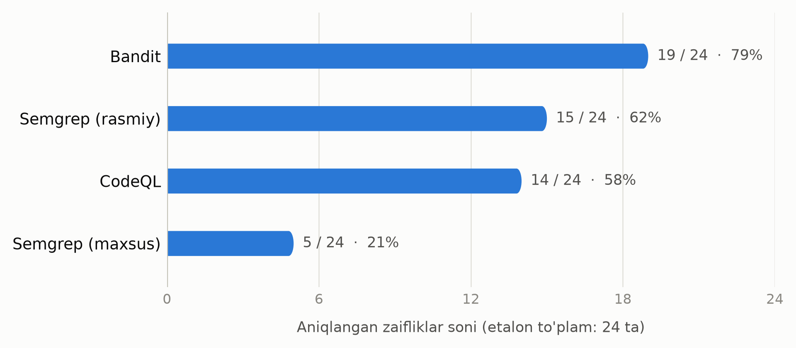
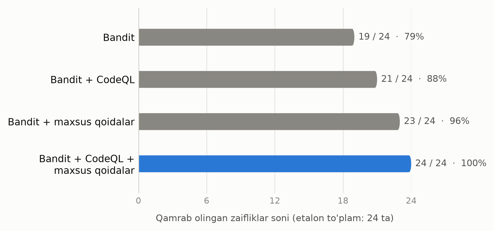

# III BOB. AMALIY QISM: VOSITALARNI QIYOSIY SINASH

## 3.1. Sinov obyekti va metodika

### Sinov ilovasi va etalon to'plam

Vositalarni qiyoslash uchun ataylab zaif qilingan Flask ilovasi ishlab
chiqildi. Tayyor etalon to'plamlar o'rniga o'z obyektini yaratish qarori
ikki sababga asoslanadi: ishning asosiy savollaridan biri — xalqaro
vositalarning o'zbek tilida nomlangan identifikatorlar bilan ishlashi,
bunday namunalar esa mavjud to'plamlarda yo'q (2.4-band); kichik va
to'liq nazorat qilinadigan obyekt esa har bir topilmani qo'lda tekshirish
imkonini beradi.

**3.1-jadval. Sinov ilovasining modullari**

| Modul | Qator soni | Mazmuni |
|---|---|---|
| `app.py` | 148 | Flask marshrutlari: qidiruv, shablon, buyruq bajarish, deserializatsiya, fayl o'qish, kirish |
| `auth.py` | 65 | Autentifikatsiya: parol xeshlash, SQL so'rov, sessiya tokeni, huquq tekshiruvi |
| `utils.py` | 80 | Yordamchi funksiyalar: fayl o'qish, tashqi so'rov, vaqtinchalik fayl, jurnalga yozish, huquqlar |
| **Jami** | **293** | |

Manba: `kod/zaif-ilova/`.

Modullarga bo'lish tasodifiy emas: bir qator zaifliklarda ma'lumot manbasi
va cho'kmasi ataylab turli fayllarga joylashtirilgan — `app.py` dagi
marshrut foydalanuvchi kiritmasini oladi va uni `utils.py` yoki `auth.py`
dagi funksiyaga uzatadi. Bu modullararo zaharlangan ma'lumot oqimini
kuzata oladigan va kuzata olmaydigan vositalarni ajratish imkonini beradi
(3.3-band). Bandit hisobotiga ko'ra tahlil qilingan kodning sof hajmi —
184 qator, `#nosec` izohi bilan chetlab o'tilgan qatorlar yo'q.

Ilovaga 24 ta zaiflik kiritilgan; har biri uchun fayl, qator, CWE kodi va
jiddiylik darajasi oldindan qayd etilgan. Shu ro'yxat etalon to'plam
(ground truth) vazifasini bajaradi va metrikalarni hisoblashning yagona
asosi hisoblanadi; to'liq ro'yxat B ilovasida keltirilgan. Zaifliklar
15 xil CWE toifasiga tegishli: CWE-78 (buyruq inyeksiyasi) va CWE-798
(qattiq kodlangan ma'lumot) — har biridan 3 tadan; CWE-89, CWE-502 va
CWE-327 — har biridan 2 tadan; qolgan 12 ta CWE bittadan vakil bilan.

Bog'liqliklardagi zaifliklar etalon to'plamga kiritilmagan.
`requirements.txt` da ataylab eskirgan oltita paket qoldirilgan (Flask
0.12.2, Jinja2 2.10, Werkzeug 0.14.1, PyYAML 5.1, requests 2.19.1,
urllib3 1.24.1); ular statik tahlil vositalari tomonidan topilmasligi
kerak va faqat SCA vositasi uchun sinov materiali bo'lib xizmat qiladi.

### Sinov muhiti va baholash metodikasi

**3.2-jadval. Sinov muhiti**

| Komponent | Versiya |
|---|---|
| Operatsion tizim | Windows 11 Pro 10.0.26200 |
| Python | 3.14.3 |
| Bandit | 1.9.4 |
| Semgrep | 1.182.1 |
| pip-audit | 2.10.1 |
| CodeQL | 2.27.3 |

Manba: `kod/natijalar/00-muhit.txt` (2026-10-26).

Vositalarning versiyalari xotiradan emas, `--version` chiqishidan olingan
va avtomatik ravishda faylga yozilgan. CI muhitida Python ning 3.12
versiyasi ishlatiladi; bu farq natijalarga ta'sir qilmadi, chunki CI dagi
topilmalar soni lokal natijalar bilan to'liq mos keldi (3.5-band).

Har bir vosita uchun TP, FP, FN hamda Precision, Recall va F1
ko'rsatkichlari hisoblanadi (formulalar 2.4-bandda); alohida ustun
sifatida takroriy xabarlar sanaladi. Hisoblash qo'lda emas,
`kod/tahlil/hisobot.py` skripti orqali bajariladi. Skript topilmani etalon
zaiflikka ikki shartdan biri bajarilganda bog'laydi: qator farqi uchtadan
oshmasa yoki topilma bilan etalon zaiflik ayni bir funksiya tanasida
joylashgan bo'lsa.

Metodikaning uch jihati muhim: **takroriy xabarlar yolg'on ijobiy deb
sanalmaydi** (aks holda ko'p qoidali to'plamlar sun'iy jazolangan
bo'lardi); **bir qatorda bir nechta zaiflik bo'lishi mumkin**
(`app.py:148` da Z-09 va Z-10), shuning uchun topilmalar avval CWE kodi,
so'ngra band bo'lmagan yozuvlar bo'yicha taqsimlanadi; **qo'lda
tekshirilgan yolg'on ijobiy natijalar alohida ro'yxatda**
(`TASDIQLANGAN_FP`). Har bir xabarning qaysi etalon yozuviga bog'langani
`kod/natijalar/moslashtirish.md` da keltirilgan, bu metrikalarni mustaqil
qayta tekshirish imkonini beradi.

**Xulosa.** Sinov obyekti — 293 qatorli, uch modulli Flask ilovasi; unga
15 xil CWE toifasiga tegishli 24 ta zaiflik kiritilib, aniq manzili
oldindan qayd etildi. Metrikalar skript orqali hisoblanadi va har bir
bog'lanish hujjatlashtiriladi, shuning uchun natijalar takrorlanuvchi.
Obyektning kichikligi statistik umumlashtirishga imkon bermaydi, lekin
har bir o'tkazib yuborishning sababini aniqlash imkonini beradi.

---

## 3.2. Vositalarni ishga tushirish va natijalar

Barcha vositalar `kod/tahlil/tahlil.sh` skripti orqali, beshta bosqichda
ketma-ket ishga tushiriladi. Chiqish fayllari `kod/natijalar/` ga
yoziladi: inson o'qishi uchun matnli, dastur qayta ishlashi uchun JSON
yoki SARIF ko'rinishida.

**Bandit** — Python uchun ixtisoslashgan, abstrakt sintaksis daraxti
asosida ishlaydigan vosita. U 22 ta topilma berdi.

**3.3-jadval. Bandit topilmalarining taqsimoti**

| Daraja | Jiddiylik bo'yicha | Ishonch bo'yicha |
|---|---|---|
| Yuqori | 8 | 17 |
| O'rta | 7 | 4 |
| Past | 7 | 1 |
| **Jami** | **22** | **22** |

Manba: `kod/natijalar/01-bandit.json` (`metrics._totals`).

22 ta xabardan 17 tasi yuqori ishonch bilan berilgan, ya'ni ishonch
darajasi jiddiylikdan sezilarli yuqori. Sababi — Bandit qoidalarining
sodda shablonlarga tayanishi: `hashlib.md5()` chaqiruvini topish uchun
oqim tahlili kerak emas. Past jiddiylikdagi yettita xabarning uchtasi esa
umuman zaiflik emas (3.3-band). Chiqish namunasi C ilovasida; e'tiborga
loyiq nuqta shundaki, Bandit `SECRET_KEY` topilmasini CWE-259 deb
belgilaydi, etalonda esa u CWE-798 — bunday nomuvofiqliklar muntazam
uchraydi.

**Semgrep** ikkita rasmiy qoidalar to'plami bilan ishga tushirildi:
`p/python` va `p/security-audit`. Natija — 26 ta topilma, xatolarsiz;
ular 24 ta noyob qoidaga tegishli, jiddiylik bo'yicha `ERROR` — 14 ta,
`WARNING` — 12 ta. Qoidalar to'plamlarining bir-birini qoplashi
qoidalarning nomlarida ham ko'rinadi: 24 ta to'liq identifikator orasida
ikkitasi bir xil qisqa nomga ega (`raw-html-format`, biri Django, biri
Flask to'plamidan) va ikkalasi ham ayni bir zaiflikda ishga tushdi.

Semgrep ning eng ko'zga tashlanadigan xususiyati — takroriy xabarlar:
26 ta topilmadan 10 tasi ayni bir zaiflik haqidagi qo'shimcha xabarlardir
(masalan, `app.py:73` dagi buyruq inyeksiyasini uchta qoida bir vaqtda
belgilaydi). Deduplikatsiyasiz bu Precision ko'rsatkichini sun'iy
pasaytiradi. Yana bir xususiyat: Semgrep taint rejimidagi qoidalarning
topilmasini **manba** qatorida, shablon asosidagi qoidalarning topilmasini
esa **cho'kma** qatorida e'lon qiladi — `app.py:43` / `app.py:48` va
`app.py:138` / `app.py:141` juftliklari shu tarzda hosil bo'lgan. Bu
3.1-banddagi uch qatorlik moslashtirish tolerantligini tushuntiradi:
tolerantliksiz manba va cho'kma xabarlari ikki turli topilma deb
hisoblanar edi.

**CodeQL** avval kodni ma'lumotlar bazasiga aylantiradi, so'ngra unga
so'rovlar beradi; tahlil `python-security-extended` to'plami bilan
bajarildi. SARIF chiqishida 50 ta so'rov e'lon qilingan, ya'ni to'plam shu
so'rovlarni kod ustida ishga tushirgan, lekin ulardan atigi 11 tasi natija
qaytardi — jami 17 ta topilma bilan (ro'yxati C ilovasida). "E'lon
qilingan 50, natija bergan 11" nisbati 3.3-banddagi tahlil uchun hal
qiluvchi: u o'tkazib yuborishning sababi so'rovning yo'qligimi yoki so'rov
ishlagani holda modeli mos kelmaganimi — degan savolga javob beradi.

**pip-audit** `requirements.txt` dagi oltita paketni ma'lum zaifliklar
bazalari bilan solishtirdi. Konsol chiqishi "Found 82 known
vulnerabilities in 6 packages" deb xabar beradi, lekin bu raqam
to'g'ridan-to'g'ri keltirilishi mumkin emas: bir xil PYSEC identifikatori
ikki manbadan (PyPI advisory bazasi va OSV) ikki marta qaytariladi.

**3.4-jadval. pip-audit: paketlar bo'yicha noyob zaifliklar**

| Paket | Versiya | Noyob zaiflik |
|---|---|---|
| urllib3 | 1.24.1 | 13 |
| werkzeug | 0.14.1 | 12 |
| jinja2 | 2.10 | 6 |
| requests | 2.19.1 | 5 |
| flask | 0.12.2 | 4 |
| pyyaml | 5.1 | 3 |
| **Jami** | **6 paket** | **43** |

Manba: `kod/natijalar/04-pip-audit.txt` (noyob PYSEC identifikatorlari
bo'yicha hisoblangan).

Ishda 43 raqami keltiriladi; bu holatning o'zi deduplikatsiya zarurligini
ko'rsatadi — vositaning xabari haqiqiy zaifliklar sonini deyarli ikki
barobar oshirib ko'rsatgan. Natijalarning mazmuni ham diqqatga sazovor:
eng ko'p zaiflik ilova bevosita chaqirmaydigan tranzitiv paketlarda —
`urllib3` va `werkzeug` da — topildi. Statik tahlil vositalari bu
zaifliklarning birortasini ham topmadi va topishi mumkin ham emas edi:
zaif kod loyihaning o'zida emas.

**3.5-jadval. Vositalarning ishlash vaqti**

| Bosqich | Takroriy ishga tushirish | GitHub Actions |
|---|---|---|
| Bandit | 2 s | 20 s |
| Semgrep (rasmiy qoidalar) | 11 s | 45 s |
| Semgrep (maxsus qoidalar) | 7 s | (yuqoridagi ish ichida) |
| pip-audit | 5 s | 13 s |
| CodeQL (baza + `security-extended`) | 57 s | 39 s |

Manbalar: lokal ustun — `kod/natijalar/00-vaqt.txt`; CI ustuni — ish (job)
davomiyligi.

Birinchi ishga tushirish vaqtlari keskin boshqacha bo'lgan: Semgrep
qoidalar bazasini tarmoqdan yuklab oladi, CodeQL esa so'rovlarni
kompilyatsiya qiladi. Loyiha jurnalida qayd etilishicha, CodeQL ning
to'liq tahlili kesh isigach 2773 soniyadan 57 soniyaga tushgan. Shu
sababli vaqt ko'rsatkichlaridan "chuqur tahlil sekin" degan xulosa
chiqarilmaydi: kesh isiganidan keyin bu hajmdagi korpusda to'rtala vosita
ham soniyalar ichida tugaydi. Tezlik bo'yicha asosli xulosa uchun ancha
katta kod bazasi kerak; bu ishning ochiq cheklovi.

**Xulosa.** To'rtta vosita bir xil kod ustida ishga tushirilib, mos
ravishda 22, 26, 17 va 43 ta natija qaytardi. Xabarlar sonining o'zi
vosita sifatini ko'rsatmaydi: Semgrep eng ko'p xabar bergan bo'lsa-da,
ularning 10 tasi takroriy; pip-audit ning 82 ta xabari esa aslida 43 ta
noyob zaiflikdir. Shu sababli keyingi bandda barcha natijalar etalon
to'plamga nisbatan normallashtiriladi.

---

## 3.3. Natijalarni qiyosiy tahlil qilish

Barcha vositalarning natijalari etalon to'plamga nisbatan
normallashtirildi; zaifliklar bo'yicha to'liq jadval C ilovasida
keltirilgan. Undan hisoblangan ko'rsatkichlar quyida.

**3.6-jadval. Vositalarning aniqlik metrikalari**

| Vosita | Topilma | TP | Takroriy | FP | FN | Precision | Recall | F1 |
|---|---|---|---|---|---|---|---|---|
| Bandit | 22 | 19 | 0 | 3 | 5 | 0,86 | **0,79** | **0,83** |
| Semgrep (rasmiy) | 26 | 15 | 10 | 1 | 9 | 0,94 | 0,62 | 0,75 |
| Semgrep (maxsus) | 5 | 5 | 0 | 0 | 19 | 1,00 | 0,21 | 0,34 |
| CodeQL | 17 | 14 | 1 | 2 | 10 | 0,88 | 0,58 | 0,70 |

Etalon to'plam: 24 ta zaiflik. Manba: `kod/natijalar/metrikalar.md`.

Birinchi kuzatuv kutilganidan farq qiladi: F1 bo'yicha eng yaxshi
natijani to'rtlikdagi eng sodda vosita — Bandit ko'rsatdi (0,83). Sabab
sinov obyektining tarkibida: etalon to'plamdagi zaifliklarning ko'pchiligi
aniq shablon bilan ifodalanadi (`hashlib.md5`, `eval`, `verify=False`,
`os.chmod(0o777)`), bunday zaifliklarni esa AST darajasidagi qoida ham
ishonchli topadi. Bu natija Bandit ning CodeQL dan kuchliroq ekanini emas,
korpus tarkibining metrikaga qanchalik kuchli ta'sir qilishini
ko'rsatadi — har qanday qiyosiy baholashda hisobga olinishi shart bo'lgan
cheklov. Ikkinchidan, keng qamrovli qoidalar to'plamiga ega uch vositaning
hech biri mukammal aniqlikka erishmadi; 1,00 ko'rsatkichi faqat ataylab
tor yozilgan maxsus qoidalarda, buning evaziga ularning Recall i atigi
0,21. Uchinchidan, hech bir vosita yolg'iz 19 tadan ko'pini topmadi — eng
yaxshi holatda ham etalon to'plamning beshdan bir qismi ko'rinmay qoldi.

### O'tkazib yuborilgan zaifliklarning sabablari

Metrikalarning o'zi vosita nima uchun zaiflikni topmaganini
tushuntirmaydi. Har bir o'tkazib yuborish qo'lda tekshirildi; to'liq
jadval C ilovasida. Sabablar bir xil sinfdan emas va uch toifaga
ajratiladi.

**Birinchi toifa — qoidaning yo'qligi.** Vositada mos qoida umuman mavjud
emas yoki ishlatilgan to'plamga kirmagan: Semgrep ning beshta (Z-15,
Z-17, Z-21, Z-22, Z-24) va CodeQL ning oltita o'tkazib yuborishi (Z-01,
Z-11, Z-12, Z-15, Z-17, Z-24) shu toifaga kiradi. Bu texnologiyaning
emas, konfiguratsiyaning cheklovi: boshqa to'plam tanlansa yoki qoida
yozilsa, zaiflik topiladi. Buni 3.4-band bevosita isbotlaydi — maxsus
qoidalar Z-22 va Z-24 ni muammosiz aniqladi.

**Ikkinchi toifa — tahlil usulining cheklovi.** Z-14 va Z-18 ni Semgrep
topa olmadi, chunki ularning manbasi va cho'kmasi turli modullarda.
Semgrep OSS modullararo zaharlangan ma'lumot oqimini kuzatmaydi, CodeQL
esa kuzatadi — va ikkala zaiflikni ham topdi. Bu ikki nuqta 2.2-banddagi
"shablon asosidagi va semantik tahlil" farqining eng toza empirik
tasdig'idir: modullararo oqim kuzatiladigan ikkala holatda semantik tahlil
yutdi, qolgan hamma joyda farq sezilmadi.

Z-18 ayniqsa ko'rsatkichli: uni **faqat CodeQL topdi** — Bandit ham,
Semgrep ning rasmiy qoidalari ham, hatto aynan shu zaiflik uchun atayin
yozilgan maxsus qoida ham (3.4-band) topa olmadi. Manba `app.py:117` dagi
`request.args.get("nom", "ozt.txt")`, cho'kma esa `utils.py:21` dagi
`os.path.join(YUKLAMALAR_PAPKASI, nom)`; oraliqda funksiya chaqiruvi va
modul chegarasi bor. CodeQL `py/path-injection` so'rovi bilan
`utils.py:22` da aniqladi.

**Uchinchi toifa — qoida mavjud, lekin ishga tushmadi.** Bu toifani faqat
SARIF ning e'lon qilingan so'rovlar ro'yxatini tekshirish orqali ajratib
olish mumkin. CodeQL ning to'rtta o'tkazib yuborishi (Z-10, Z-13, Z-16,
Z-22) shunday: tegishli so'rov to'plamda bor va kod ustida ishlagan, lekin
natija bermagan. Z-10 uchun sabab aniq — so'rov soket darajasidagi `bind`
chaqiruvini modellaydi, kod esa Flask ning `app.run(host="0.0.0.0")`
chaqiruvidan foydalanadi, ya'ni kutubxona modelidagi bo'shliq (2.5-band).
Z-13 va Z-22 uchun sabab boshqacha va keyingi kichik bo'limning mavzusi
bilan bog'liq.

### Vositalarning o'zbekcha identifikatorlarga munosabati

Ushbu ishning eng o'ziga xos natijasi tasodifan olindi. Etalon to'plamda
qattiq kodlangan ma'lumotlar uchta zaiflik bilan ifodalangan: `SECRET_KEY`
(Z-01, inglizcha nom), `DB_PAROL` (Z-11) va `API_KALIT` (Z-12) —
ikkinchisi va uchinchisi o'zbekcha nomlangan, uchalasi esa struktura
jihatidan bir xil: modul darajasida satr literali o'zgaruvchiga
o'zlashtirilgan.

Natija keskin farqlandi. Bandit `B105` qoidasi bilan `SECRET_KEY` ni
topdi, lekin `DB_PAROL` va `API_KALIT` ni topmadi; Semgrep ning rasmiy
qoidalari ham faqat `SECRET_KEY` ni topdi. CodeQL uchalasini ham topmadi,
lekin boshqa sababga ko'ra — uning to'plamida bu sinf uchun so'rov umuman
yo'q edi. Sabab `B105` qoidasining tuzilishida: u satr literali
o'zlashtirilgan o'zgaruvchi nomini inglizcha kalit so'zlar ro'yxati bilan
solishtiradi (`password`, `pass`, `secret`, `token`, `key`). `SECRET_KEY`
bu ro'yxatga tushadi, `DB_PAROL` va `API_KALIT` esa tushmaydi. Shunday
qilib, **qoidaning ishlashi o'zgaruvchi nomining tiliga bog'liq**.

Bu kuzatuv CodeQL ning ikkita tushunarsiz o'tkazib yuborishini ham
izohlashi mumkin. Z-13 da parol `hashlib.md5(parol.encode())` ko'rinishida
xeshlanadi, Z-22 da esa `logging.info("... parol=%s", login, parol)`
orqali jurnalga yoziladi; ikkala holat uchun ham tegishli so'rov SARIF da
e'lon qilingan, lekin natija bermadi. Bu so'rovlarning ikkalasi ham
ma'lumotning **maxfiy** deb tanilishini talab qiladi, maxfiylikni aniqlash
esa CodeQL da nom evristikasiga tayanadi — o'zgaruvchi `parol` deb
nomlangan, ya'ni gipoteza shundaki, bu yerda ham til to'sig'i ishlagan.
Gipotezani tasdiqlash uchun nazorat tajribasi kerak: o'zgaruvchilarni
`password` ga qayta nomlab, CodeQL ni qayta ishga tushirish. Ushbu ishda
bunday tajriba o'tkazilmadi, shuning uchun Z-13 va Z-22 bo'yicha xulosa
gipoteza darajasida qoldiriladi. Bandit bo'yicha xulosa esa gipoteza emas:
u bevosita o'lchangan.

Amaliy ahamiyati jiddiy: milliy tilda yozilgan kod bazalarida xalqaro
vositalarning nomga tayanadigan qoidalari ishlamay qoladi, ishlab
chiquvchi esa buni bilmaydi — vosita xato bermaydi, shunchaki jim qoladi.
Yechim maxsus qoidalar bo'lib, u 3.4-bandda ko'rib chiqiladi.

### Yolg'on ijobiy natijalarning tahlili

Jami oltita yolg'on ijobiy natija qayd etildi va ular ikki toifaga
ajratiladi.

**3.7-jadval. Yolg'on ijobiy natijalarning toifalari**

| Toifa | Vosita | Topilma | Mohiyati |
|---|---|---|---|
| I. Oqim umuman tahlil qilinmaydi | Bandit | `app.py:17`, `app.py:19`, `utils.py:8` (B403, B404) | Import ko'ringani uchun ogohlantirish beriladi; modul ishlatilishi tahlil qilinmaydi |
| II. Oqim to'g'ri, cho'kma konteksti baholanmaydi | Semgrep | `app.py:124` (`open-redirect`, CWE-601) | Qayta yo'naltirish manzili `/profil?ism=` prefiksi bilan qattiq bog'langan |
| II | CodeQL | `app.py:91`, `app.py:101` (`py/reflective-xss`) | Qaytarilgan lug'at `application/json` javobiga aylanadi; brauzer uni HTML deb talqin qilmaydi |

Manbalar: `kod/natijalar/metrikalar.md`, `kod/zaif-ilova/ZAIFLIKLAR.md`.

**Birinchi toifa — eng sodda.** Bandit ning uchala yolg'on ijobiy natijasi
`import` operatorlariga berilgan ogohlantirishdir. Modulni import qilish
o'zi zaiflik emas; qoida faqat import faktini ko'radi va modul qanday
ishlatilishini tahlil qilmaydi. Bunday xabarlarni konfiguratsiya orqali
o'chirish oson, lekin ularning mavjudligi vositaning tahlil chuqurligini
aniq ko'rsatadi.

**Ikkinchi toifa — ancha nozik.** Bu holatlarda qoida ma'lumot oqimini
**xatosiz** kuzatadi: SARIF dagi `codeFlows` ni tekshirganda CodeQL
manbadan cho'kmagacha bo'lgan yo'lni to'g'ri aniqlagani ko'rinadi. Xato
oqimda emas, cho'kma kontekstini baholashda. Semgrep ning ochiq qayta
yo'naltirish topilmasi ayniqsa o'rganarli: qoida "so'rov ma'lumoti
`redirect()` ga yetib bordi" deb xabar beradi, lekin manzilning qattiq
kodlangan `/profil?ism=` prefiksi bilan boshlanishini hisobga olmaydi —
hujumchi faqat so'rov satri qiymatini boshqaradi va boshqa saytga
yo'naltira olmaydi. CodeQL bu yerda jim qoldi, garchi `py/url-redirection`
so'rovi to'plamda e'lon qilingan bo'lsa ham: uning modeli hujumchi host
nomini o'zgartira olishini talab qiladi.

Bitta misolda ikkala yondashuvning farqi ko'rinadi: shablon asosidagi
qoida oqimni kuzatadi va ogohlantiradi; semantik so'rov ekspluatatsiya
shartini modellaydi va shart bajarilmasa jim qoladi. Farq bir tomonlama
emas — aynan CodeQL ikkita `py/reflective-xss` yolg'on ijobiy natijasini
berdi, chunki uning modeli javobning `Content-Type` sarlavhasini hisobga
olmaydi. Bu topilmalar dastlab Z-05 va Z-06 ning takroriy xabari deb
hisoblangan edi; tekshiruv buni rad etdi, zero ular boshqa sinf (CWE-79)
haqida da'vo qiladi. Tuzatishdan keyin CodeQL ning Precision ko'rsatkichi
1,00 dan 0,88 ga, F1 esa 0,74 dan 0,70 ga tushdi. Metodologik xulosa:
takroriy xabar va yolg'on ijobiy natijani ajratishda joylashuv emas,
da'voning mazmuni hal qiluvchi bo'lishi kerak.

### Vositalarni birgalikda qo'llash

Alohida vositalarning ko'rsatkichlari ularning birgalikdagi qiymatini
ifodalamaydi. Qoplamani hisoblash uchun ochko'z (greedy) tartib qo'llandi:
har qadamda etalon to'plamga eng ko'p **yangi** zaiflik qo'shadigan vosita
tanlanadi.

**3.8-jadval. Vositalarni birgalikda qo'llashdagi qoplama**

| Qadam | Qo'shilgan vosita | Qoplama |
|---|---|---|
| 1 | Bandit | 19 / 24 |
| 2 | + Semgrep (maxsus qoidalar) | 23 / 24 |
| 3 | + CodeQL | **24 / 24** |

Manba: `kod/tahlil/diagramma.py`.

Birinchidan, **uchta vosita birgalikda to'liq qoplama beradi**, holbuki
hech biri yolg'iz 19 tadan ko'pini topmadi. Bu ishning asosiy amaliy
dalili va 1.2-banddagi nazariy qoidani tasdiqlaydi. Ikkinchidan — va bu
kutilmagan natija — **Semgrep ning rasmiy qoidalari bu ketma-ketlikka
umuman kirmadi**: ular topgan 15 ta zaiflikning hammasini yuqoridagi
uchlik allaqachon qamrab oladi, ya'ni to'plamga qo'shilganda qoplamani bir
birlikka ham oshirmaydi. Bu "ko'proq vosita — ko'proq qoplama" degan sodda
qoidani rad etadi.

Natijalar ikkita diagrammada ko'rsatilgan. Diagrammalardagi raqamlar
qo'lda kiritilmagan — ular `hisobot.py` ning moslashtirish mantiqidan
hisoblanadi, ya'ni vositalar chiqishi o'zgarsa rasm ham o'zgaradi.



*3.1-rasm. Vositalarning etalon zaifliklarni aniqlash ulushi*



*3.2-rasm. Vositalarni birgalikda qo'llashdagi qamrov*

Natijalarni solishtirishda alohida texnik muammo yuzaga keldi: vositalar
ayni bir zaiflikka turli CWE kodini beradi — `0.0.0.0` ga bog'lanish
(Z-10) uchun Bandit CWE-605, Semgrep CWE-668; `SECRET_KEY` (Z-01) uchun
Bandit CWE-259, etalon CWE-798; CodeQL esa bitta so'rovga bir necha kod
beradi. Demak moslashtirishni CWE bo'yicha to'liq avtomatlashtirib
bo'lmaydi; `hisobot.py` shu sababli kodlar to'plami bilan ishlaydi va
asosiy moslashtirishni joylashuv bo'yicha amalga oshiradi. Amaliy xulosa:
bir necha SAST vositasi natijasini birlashtiruvchi tizim CWE ni yagona
kalit sifatida ishlatmasligi kerak.

**Xulosa.** Eng yaxshi F1 ko'rsatkichini (0,83) eng sodda vosita
ko'rsatdi, lekin bu korpus tarkibining ta'siri. O'tkazib yuborishlarning
aksariyati texnologiya cheklovi emas, qoida to'plamining bo'shlig'i: faqat
ikkita holatda (Z-14, Z-18) sabab chinakam texnik — modullararo oqim
kuzatilmasligi, va ikkalasini ham semantik tahlil hal qildi. Yolg'on
ijobiy natijalar ikki toifaga bo'linadi: oqim umuman tahlil qilinmaydi
yoki oqim to'g'ri kuzatiladi-yu, cho'kma konteksti baholanmaydi. Uch
vosita birgalikda to'liq qoplama beradi, to'rtinchisi esa hech narsa
qo'shmaydi.

---

## 3.4. Maxsus qoida ishlab chiqish

**Muammoning qo'yilishi.** 3.3-bandda aniqlangan til bog'liqligi standart
konfiguratsiya doirasida hal qilinmaydi: `B105` qoidasining kalit so'zlar
ro'yxatini tashqaridan kengaytirib bo'lmaydi. Qoidalarni yozish uchun
Semgrep tanlandi: qoida YAML da, kodning o'ziga o'xshash shaklda
ifodalanadi va taint rejimi ham qo'llab-quvvatlanadi. Jami beshta qoida
ishlab chiqildi (`kod/tahlil/qoidalar/maxsus-qoidalar.yml`); quyida eng
ahamiyatlisi bosqichma-bosqich ko'rib chiqiladi.

**Qoida mantiqi.** Aniqlanishi kerak bo'lgan naqsh: satr literali shunday
o'zgaruvchiga o'zlashtiriladiki, uning nomida maxfiylikni bildiruvchi
so'z bor. Mantiq ikki shartning kesishmasidan iborat: **strukturaviy
shart** — ifoda `$NOM = "..."` ko'rinishida bo'lishi (`"..."` — Semgrep
ning istalgan satr literalini ifodalovchi metashabloni); **nom sharti** —
`$NOM` metao'zgaruvchisi maxfiylikni bildiruvchi so'zlar ro'yxatiga mos
kelishi. Muammoning yechimi ikkinchi shartda: ro'yxatga o'zbekcha
o'zaklar (`parol`, `kalit`, `maxfiy`, `sir`, `kirish_kodi`) ham, xalqaro
atama (`token`) ham kiritiladi; solishtirish registrga sezgir emas,
chunki Python da bunday konstantalar bosh harflar bilan yoziladi.

**Qoidaning YAML kodi.**

```yaml
- id: ozbekcha-qattiq-kodlangan-sir
  patterns:
    - pattern-either:
        - pattern: $NOM = "..."
        - pattern: $NOM = '...'
    - metavariable-regex:
        metavariable: $NOM
        regex: (?i).*(parol|kalit|maxfiy|sir|token|kirish_kodi).*
  message: >-
    Qattiq kodlangan maxfiy ma'lumot aniqlandi ($NOM). Sirlar kod
    ichida saqlanmasligi kerak — muhit o'zgaruvchisi yoki maxsus
    sir boshqaruvi tizimidan foydalaning.
  languages: [python]
  severity: ERROR
  metadata:
    cwe: "CWE-798: Use of Hard-coded Credentials"
```

`patterns` ro'yxatidagi shartlar VA mantig'i bilan birlashtiriladi,
`pattern-either` ichida YOKI mantig'ini beradi. `metavariable-regex`
bo'limi aynan til muammosini hal qiladigan joy, `metadata.cwe` maydoni esa
topilmaning etalon bilan avtomatik moslashtirilishini ta'minlaydi.

**Sinov natijasi.** Maxsus qoidalar to'plami 5 ta topilma berdi.

**3.9-jadval. Maxsus qoidalarning natijalari**

| Qoida | Topilma | Etalon | Boshqa vositalar topganmi |
|---|---|---|---|
| `flask-shablon-inyeksiyasi` | app.py:64 | Z-03 | Semgrep (rasmiy), CodeQL |
| `ozbekcha-qattiq-kodlangan-sir` | auth.py:12 | Z-11 | **hech biri** |
| `ozbekcha-qattiq-kodlangan-sir` | auth.py:16 | Z-12 | **hech biri** |
| `jurnalga-maxfiy-malumot` | utils.py:54 | Z-22 | **hech biri** |
| `etiborsiz-istisno` | utils.py:65 | Z-24 | Bandit (`B110`) |
| `yol-boylab-harakatlanish` | — | — | CodeQL (Z-18 ni topdi) |

Manba: `kod/natijalar/03-semgrep-maxsus.json`.

Beshta topilmaning hammasi haqiqiy zaiflik, yolg'on ijobiy natija yo'q
(Precision 1,00). Muhimi esa shundaki, **uchta zaiflikni (Z-11, Z-12,
Z-22) sinovdagi boshqa hech bir vosita topmagan edi** — ya'ni bir necha
o'nlab qator YAML kodi uchta xalqaro vosita birgalikda ko'ra olmagan
zaifliklarni aniqladi. Qoidalar to'plamining Recall ko'rsatkichi atigi
0,21, lekin bu kutilgan natija: qoidalar rasmiy to'plamlarni almashtirish
uchun emas, ulardagi aniq bo'shliqlarni to'ldirish uchun mo'ljallangan.

**Muvaffaqiyatsiz qoida va undan olingan saboq.** Beshinchi qoida —
`yol-boylab-harakatlanish` — Z-18 ni aniqlash uchun atayin yozilgan edi va
**hech qanday topilma bermadi**; bu salbiy natija ijobiylaridan kam
ahamiyatli emas. Qoida taint rejimida yozilgan: manba
`request.args.get(...)`, cho'kma `open(...)` va `os.path.join(...)`,
tozalagich `os.path.basename(...)` va `secure_filename(...)`. Mantiq
to'g'ri va kodda bu naqsh aynan mavjud, lekin manba `app.py:117` da,
cho'kma esa `utils.py:21` da — oraliqda funksiya chaqiruvi va modul
chegarasi bor. Semgrep OSS modullararo (interfile) oqimni kuzatmaydi.
Bundan ikki xulosa kelib chiqadi: maxsus qoida qoidalar bazasidagi
bo'shliqni to'ldira oladi, lekin tahlil usulidagi cheklovni chetlab o'ta
olmaydi; va Z-18 ni faqat CodeQL topgani tasodif emas — modullararo oqim
uchun semantik tahlil muqobilsiz.

**Xulosa.** Beshta maxsus qoidadan to'rttasi ishladi va uchta zaiflikni
aniqladiki, ularni sinovdagi boshqa hech bir vosita topmagan edi; yolg'on
ijobiy natija bo'lmadi. Beshinchi qoida ishlamadi va buning sababi qoida
mantiqida emas, Semgrep OSS ning modullararo oqimni kuzatmasligida.
Maxsus qoidalar qoidalar bazasidagi bo'shliqni arzon to'ldiradi, lekin
tahlil usulining chegarasini siljita olmaydi.

---

## 3.5. CI/CD ga integratsiya

**Workflow tuzilmasi.** Statik tahlil vositalarini uzluksiz integratsiya
quvuriga joylashtirish uchun GitHub Actions workflow ishlab chiqildi
(`.github/workflows/sast.yml`). U uchta hodisada ishga tushadi: `main`
shoxiga push qilinganda, pull request ochilganda va har dushanba soat
06:00 (UTC) da jadval bo'yicha — oxirgisi muhim, chunki kod o'zgarmasa
ham yangi CVE lar e'lon qilinishi bog'liqliklar holatini o'zgartiradi.
Workflow beshta ishdan iborat: Bandit, Semgrep (rasmiy va maxsus
qoidalar), CodeQL, bog'liqliklar tahlili va yakuniy umumiy hisobot;
birinchi to'rttasi parallel bajariladi. Ruxsatlar eng kam imtiyoz
tamoyili bo'yicha berilgan: `contents: read` va `security-events: write`.

**SARIF va natijalarni birlashtirish.** Har bir vosita natijasini SARIF
formatida chiqaradi va `upload-sarif` amali orqali yuklanadi; har bir
yuklashga alohida `category` beriladi, aks holda keyingi yuklash
oldingisining natijalarini almashtirib yuboradi. Aynan shu nuqta birinchi
ishga tushirishda nuqson sifatida namoyon bo'ldi:
`semgrep-maxsus.sarif` yaratilar, lekin yuklash bosqichi faqat
`semgrep.sarif` ni olardi — natijada 3.4-bandning asosiy natijasi Security
tabiga umuman yetib bormasdi.

**Sifat darvozasi.** Workflow da ikkita darvoza o'rnatilgan. Bandit
darvozasi tahlil bosqichidan ajratilgan: tahlil `--exit-zero` bilan
ishlaydi (vazifasi — SARIF yaratish), darvoza esa chegara bilan qayta
ishga tushiriladi (`--severity-level high --confidence-level medium`).
Chegara tanlovi tasodifiy emas: lokal natijalarga ko'ra bu shartga 22 ta
topilmadan 8 tasi javob beradi, past jiddiylikdagi yettita xabar — shu
jumladan uchta yolg'on ijobiy natija — darvozadan o'tib ketadi. Ya'ni
darvoza qurilishni faqat jiddiy topilma uchun to'xtatadi, bu 1.3-bandda
ta'riflangan muvozanatning amaliy ifodasi. SCA darvozasi pip-audit ni
ikkinchi marta ishga tushiradi: zaif bog'liqlik topilsa, ish to'xtaydi.

**Ishga tushirish natijalari.** Workflow `nyxeldev/kurs-ishi-sast`
omborida bir necha marta ishga tushirildi; ishlar bo'yicha natijalar va
GitHub Security tabidagi ogohlantirishlar D ilovasida keltirilgan. Beshta
ishdan uchtasi muvaffaqiyatli tugadi, ikkitasi esa xato bilan — ikkala
xato ham kutilgan, chunki sifat darvozalari ataylab zaif kod bazasida ishga
tushdi; barcha tahlil va SARIF yuklash bosqichlari muvaffaqiyatli o'tdi.

Security tabidagi ogohlantirishlar soni lokal ishga tushirish
natijalariga to'liq mos keldi — Semgrep 26, Bandit 22, CodeQL 17, maxsus
qoidalar 5, jami 70. Bu amaliy qismning takrorlanuvchanligini tasdiqlaydi:
CI va lokal muhit, turli operatsion tizim va Python versiyasiga qaramay,
bir xil topilmalarni berdi.

**Joriy etish bo'yicha tavsiyalar.** Bitta vosita bilan cheklanmaslik
kerak: to'liq qoplama faqat uchta vosita birgalikda erishildi. Bazaviy
daraja — tilga ixtisoslashgan tez vosita har bir commit da; semantik
tahlil modullararo oqimni talab qiladigan zaifliklarni qoplaydi; SCA esa
statik tahlil umuman ko'rmaydigan sohani tekshiradi. Yangi vosita
to'plamga faqat boshqalar ko'rmaydigan sinf zaifliklarni topsagina
qo'shilishi kerak. Milliy tilda yozilgan kod bazalari uchun maxsus
qoidalar zarur; darvoza chegarasi yolg'on ijobiy natijalar tushmaydigan
qilib tanlanadi; har bir vosita natijasi o'z kategoriyasi bilan SARIF da
yuklanishi shart.

**Xulosa.** Beshta ishdan iborat workflow ishlab chiqildi va amalda ishga
tushirildi: to'rtta vosita natijasi SARIF orqali bitta interfeysda
jamlandi, ikkita sifat darvozasi esa kutilganidek qurilishni to'xtatdi.
CI dagi topilmalar soni lokal natijalarga to'liq mos keldi. Integratsiya
jarayonida ikkita haqiqiy nuqson aniqlanib tuzatildi, shundan biri —
maxsus qoidalar natijasining yo'qolishi — ishning asosiy natijasini
Security tabidan butunlay yashirgan bo'lardi.
